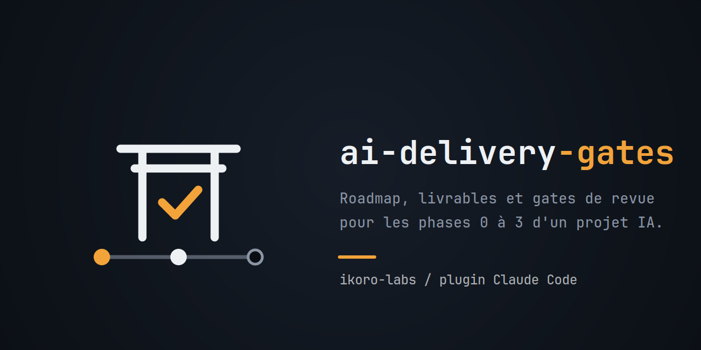

# ai-delivery-gates



Un plugin Claude Code qui conduit un projet IA phase par phase, de la première question au system
design : spike, cadrage, spécifications, system design. Chaque phase produit ses livrables par
entretien, et ne se clôt qu'après la relecture de trois agents indépendants.

Le plugin encode le playbook v2 et ses templates, et ajoute six checkpoints : parties prenantes,
alternatives et existant, matrice coût d'erreur et niveau d'autonomie, checkpoint réglementaire,
jeu d'éval amorcé dès la phase 1, adoption.

## Comment ça marche

1. **On démarre le projet.** « Je démarre un projet IA... » ou `/ai-delivery-gates:projet-ia` :
   l'orchestrateur crée `docs/projet/etat.md`, fixe le profil et la taille du projet, et lance la
   phase 0.
2. **Chaque phase écrit ses livrables.** Sous `docs/projet/0N-<phase>/`, par entretien : rien n'est
   inventé, une case inconnue reste « à vérifier ».
3. **Trois agents relisent.** « On peut clore la phase ? » lance `/ai-delivery-gates:revue-de-phase` :
   `lead-tech`, `product-owner` et `expert-metier` relisent chacun de leur côté, puis la revue
   consolide, mène un pré-mortem et rend un verdict. La phase se clôt quand tous les bloquants sont
   levés, et chaque majeur levé ou accepté avec un motif daté.
4. **Pas de code avant le cadrage.** Tant que la phase 1 n'est pas close, le hook `garde-code`
   refuse l'écriture de code applicatif.

Une revue se demande aussi à tout moment, sur n'importe quel document : « challenge-moi sur ce
cadrage ».

## Ce que le plugin apporte

| Skill | Pour |
| --- | --- |
| `/ai-delivery-gates:projet-ia` | l'orchestrateur : état du projet, profil et taille, boucle de phase, points de sortie |
| `/ai-delivery-gates:spike` | phase 0 : question binaire, timebox, résultat mesuré, code jeté |
| `/ai-delivery-gates:cadrage` | phase 1 : fiche de cadrage, one-pager, risques, checkpoint réglementaire, matrice coût d'erreur, go/no-go, critères d'arrêt |
| `/ai-delivery-gates:specifications` | phase 2 : stories, non-goals, parcours, spec API, spec data, NFR |
| `/ai-delivery-gates:system-design` | phase 3 : fiches modèle, architecture, ADR, agents et RAG, plan d'éval, coûts, frontière de confiance |
| `/ai-delivery-gates:revue-de-phase` | la gate : lance les trois agents, consolide, pré-mortem, verdict |

| Agent | Rôle |
| --- | --- |
| `ai-delivery-gates:lead-tech` | faisabilité, architecture, coûts, sécurité, évaluabilité |
| `ai-delivery-gates:product-owner` | valeur, utilisateurs, métriques, périmètre, adoption |
| `ai-delivery-gates:expert-metier` | réalisme terrain, vocabulaire, réglementation du domaine |

| Hook | Ce qu'il garde |
| --- | --- |
| `garde-code` | pas d'écriture de code applicatif tant que la phase 1 n'est pas close |

## Prérequis

- Claude Code.
- [uv](https://docs.astral.sh/uv/) : le hook se lance par `uv run --no-project --quiet python`, ce
  qui évite l'absence de `python3` sous Windows. Sans uv, la commande échoue en erreur non bloquante
  et la garde est inactive : le vérifier avec `/hooks` et un essai d'écriture refusé.

## Installer dans un projet

Le plugin est distribué par la marketplace `ikoro-labs`, servie par le dépôt
[`ikoro-labs/forge`](https://github.com/ikoro-labs/forge), qui l'épingle sur une version publiée :

```sh
claude plugin marketplace add ikoro-labs/forge
claude plugin install ai-delivery-gates@ikoro-labs
```

Dans une session, `/plugin marketplace add ikoro-labs/forge` puis
`/plugin install ai-delivery-gates@ikoro-labs` font la même chose. Pour une nouvelle version :
`claude plugin marketplace update ikoro-labs`, puis `claude plugin update ai-delivery-gates@ikoro-labs`.

Pour essayer le plugin depuis un clone, sans l'installer : `claude --plugin-dir <ce dépôt>`.

## Configurer

**Le fichier d'état.** `docs/projet/etat.md`, au format décrit dans
[`skills/projet-ia/references/etat-projet.md`](skills/projet-ia/references/etat-projet.md). Son
en-tête porte `phases_closes` et `garde_code`, que lit le hook.

**La garde.** Tant que `1` n'est pas dans `phases_closes`, toute écriture hors de `docs/`, `spike/`,
`.claude/` et des fichiers `.md` ou `.txt` est refusée, avec son motif. Pour la lever :
`garde_code: off` dans l'en-tête, avec une ligne datée dans le journal. Le hook ne fait rien dans
un projet sans `docs/projet/etat.md`.

**Les domaines.** Un fichier par domaine récurrent dans
`skills/revue-de-phase/references/domaines/`, que lit l'expert métier. Copier `_template.md` pour
un nouveau domaine ; `batiment-controle-technique.md` est une amorce dont les lignes « à vérifier »
doivent être contrôlées. Les autres fichiers de domaine sont ignorés par git : ils restent locaux,
car ils portent souvent du contexte d'organisation ou de projet. L'expert métier propose en fin de
revue les lignes à ajouter.

**Les agents.** `model: inherit` par défaut ; passer `opus` dans le front matter de chaque agent
pour forcer le modèle le plus puissant en revue. Pour un agent hors ligne, retirer `WebSearch` et
`WebFetch` de sa liste `tools`. La règle de clôture et le nombre de passages sont dans
[`skills/revue-de-phase/SKILL.md`](skills/revue-de-phase/SKILL.md), section 5.

## Limites connues

- Le plugin n'a pas encore été conduit sur un projet réel : à itérer sur deux ou trois cas.
- Le fichier de domaine bâtiment est une amorce, pas une référence vérifiée.
- Le hook couvre Write, Edit, MultiEdit et NotebookEdit ; une écriture par Bash n'est pas
  interceptée.

## Aller plus loin

| Page | Contenu |
| --- | --- |
| [`skills/projet-ia/references/playbook.md`](skills/projet-ia/references/playbook.md) | le playbook que le plugin encode |
| [`docs/contribuer.md`](docs/contribuer.md) | modifier le plugin, publier une version, l'organisation du dépôt |
| [`CHANGELOG.md`](CHANGELOG.md) | ce qui est entré dans chaque version |

## Licence

MIT ([`LICENSE`](LICENSE)).
