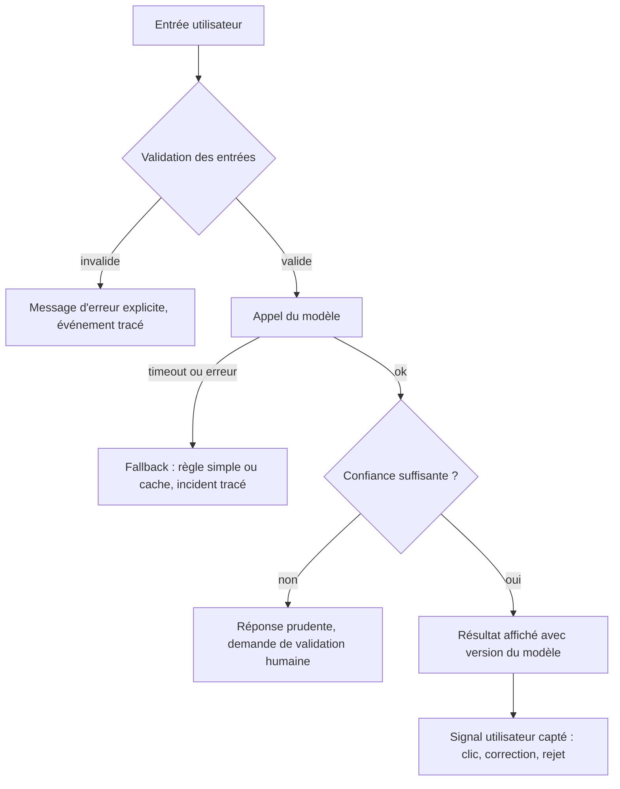

# Parcours utilisateur bout-en-bout : [nom du projet]

Destinataire : ... | Date : ...

Un diagramme par cas d'usage du MVP (donc en général un seul). Le chemin nominal et, pour chaque dépendance
(modèle, donnée, service tiers, humain qui valide), le chemin d'échec : ce que l'utilisateur voit, ce que le
système fait, ce qui est tracé.

## Points de contrôle humain
Où l'humain valide, selon le niveau d'autonomie choisi en 1.3 bis : ...

## Ce que voit l'utilisateur quand ça échoue
| Panne | Message ou comportement visible | Délai | Tracé où |
|---|---|---|---|

## Stories révélées par le parcours
Liste des stories manquantes découvertes en dessinant le parcours, à ajouter au backlog ou aux non-goals.
