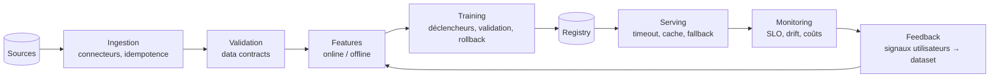

# Architecture : [nom du projet]

Destinataire : ... | Date : ...

## 3.1 Diagramme global
Chaque boîte porte le numéro de la story ou le SLO qui la justifie.

## 3.4 Features
| Feature | Online ou offline | Fraîcheur requise | Source | Feature store (oui/non, pourquoi) |
|---|---|---|---|---|

## 3.5 Training
- Déclencheurs de réentraînement (calendrier, drift, volume de feedback) :
- Validation avant promotion (golden set, seuils) :
- Rollback (comment, en combien de temps, qui) :
- Budget de calcul plafonné (coût, durée) :

## 3.6 Serving
- Batch ou temps réel, et pourquoi :
- Timeout par appel modèle :
- Fallback si modèle indisponible (règle, cache, version précédente) :
- Caching (réponses, embeddings) :
- Version du modèle dans chaque réponse : oui

## Composants écartés
Ce qui n'est pas dans le diagramme et pourquoi (renvoi aux non-goals).
