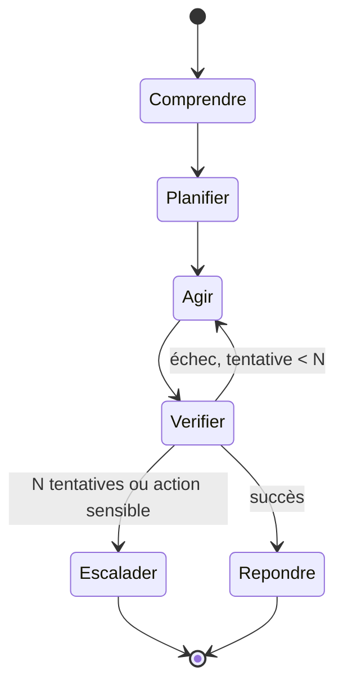

# Design agents : [nom du projet]

Destinataire : ... | Date : ...

Un agent est un programme dont le contrôle de flux dépend d'un modèle. Tout ce qui n'est pas borné par
construction finira par être dépassé par le modèle : nombre d'étapes, coût, privilèges.

## Graphe d'états

## Tools
| Tool | Ce qu'il fait | Lecture ou écriture | Privilège minimal (scope, données) | Entrée non fiable ? | Validation humaine requise ? | Erreurs possibles et gestion |
|---|---|---|---|---|---|---|

## Limites par session
| Limite | Valeur | Comportement quand atteinte |
|---|---|---|
| Nombre d'étapes | | arrêt et escalade |
| Coût (tokens, euros) | | arrêt et message |
| Durée | | |
| Actions d'écriture | | confirmation humaine |

## Garde-fous
- Ce que l'agent ne peut jamais faire (liste explicite, vérifiée par code, pas par prompt) :
- Points de contrôle humain selon le niveau d'autonomie (matrice 1.3 bis) :
- Traitement du contenu récupéré (documents, pages, outputs de tools) comme non fiable : comment c'est isolé du
  canal d'instructions :

## Mémoire
Ce qui est conservé entre sessions, où, combien de temps, avec quelles données personnelles.

## Observabilité
Tracing des sessions, coût par session, conversations à problème repérables (critère).
