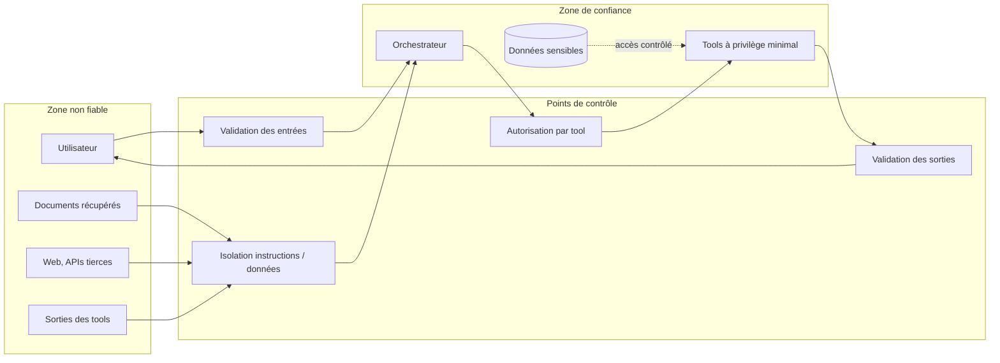

# Frontière de confiance : [nom du projet]

Destinataire : ... | Date : ...

Principe : tout ce qui n'est pas écrit par l'équipe est une entrée non fiable, y compris les documents de
l'entreprise récupérés par un RAG, les pages web, les sorties des tools et les messages des utilisateurs.
Une entrée non fiable peut contenir des instructions ; le système ne doit jamais les exécuter comme si elles
venaient du code.

## Schéma

## Inventaire
| Source d'entrée | Fiable ? | Peut contenir des instructions ? | Point de contrôle | Ce qui est fait en cas de contenu suspect |
|---|---|---|---|---|

| Tool | Privilèges (lecture, écriture, envoi, paiement) | Données accessibles | Confirmation humaine | Journalisé |
|---|---|---|---|---|

| Donnée sensible | Où elle vit | Qui y accède | Dans les prompts ? (non sauf nécessité écrite) | Dans les logs ? (non) |
|---|---|---|---|---|

## Checklist (inspirée de l'OWASP Top 10 for LLM Applications, vérifier la version en vigueur)
- [ ] Injection de prompt directe : entrées utilisateur validées, consignes système non modifiables par l'entrée.
- [ ] Injection indirecte : contenu récupéré isolé, jamais interprété comme instruction.
- [ ] Excès d'autonomie : chaque tool a le privilège minimal, les actions irréversibles exigent une confirmation.
- [ ] Fuite d'informations sensibles : PII et secrets hors prompts et hors logs sauf nécessité écrite.
- [ ] Chaîne d'approvisionnement : modèles, poids, datasets et dépendances avec provenance et licence vérifiées.
- [ ] Sorties : validées avant exécution (code, requêtes, liens) et avant affichage.
- [ ] Déni de service et coût : limites par session et par utilisateur.
- [ ] Journalisation : chaque action de tool est tracée avec l'identifiant de session.
